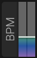

# BPM (Tempo)

## Overview

BPM (Beats Per Minute) controls the internal tempo for all tempo-synchronized features.

## Parameters

### Tempo

- **Range**: 20 to 300 BPM
- **Default**: 120 BPM
- **Sync**: Can sync to host DAW tempo

### Sync Mode

#### Internal

helmBoy uses its own internal tempo setting.

#### Host Sync

helmBoy synchronizes to the host DAW's tempo.

- Automatically follows tempo changes in DAW
- Recommended for DAW projects

#### MIDI Clock

Synchronizes to external MIDI clock messages.

## Tempo-Synced Features

The following features can synchronize to tempo:

- **LFO Rate**: Musical divisions (1/4, 1/8, etc.)
- **Delay Time**: Rhythmic delays
- **Arpeggiator**: Note divisions
- **Step Sequencer**: Step timing
- **Stutter Effect**: Rhythmic stuttering

## Usage

### In DAW

Enable Host Sync for automatic tempo tracking.

### Standalone

Set internal tempo or use MIDI clock sync.

### Live Performance

Use tap tempo (if available) or MIDI clock for synchronization.

## See Also

- [Arp](arp.md)
- [Notes Synchro](notes-synchro.md)
