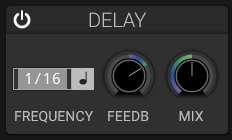

# Delay

## Overview

The delay effect creates echoes by repeating the input signal at specified intervals.

## Controls

### Frequency and Sync

- Choose free-running time or synchronize the delay to the current tempo.
- Tempo divisions include straight, dotted, and triplet values.

### Ping-Pong

The **PP** switch cross-feeds the stereo delay lines. Wet echoes alternate
between left and right; when disabled, each channel feeds back into itself.

### Feedback

- **Range**: 0% to 100%
- **Effect**: Amount of delayed signal fed back into the delay
- **High values**: Create long, evolving echoes

### Dry/Wet Mix

Balance between original signal and delayed signal.

### Delay LP Cutoff

The **LP** control applies a 24 dB/octave low-pass filter to the delayed taps,
including the signal sent back into the feedback loop. It does not affect the
dry signal. The maximum setting bypasses the filter so existing patches retain
their original delay sound. The cutoff can be automated and modulated.
The filter is a pair of cascaded Butterworth biquads per channel; cutoff changes
are smoothed over 10 ms, and ping-pong routing remains after the per-channel
filtering.

The delay-time control is shared by both stereo channels. The section also
provides feedback, dry/wet mix, sync, ping-pong, and an on/off switch; it does
not provide separate left/right delay times or separate filter controls for
the stereo channels.

## Applications

- Rhythmic patterns
- Spatial depth
- Ambient textures
- Doubling effects

## See Also

- [Reverb](reverb.md)
- [Distortion](distortion.md)
