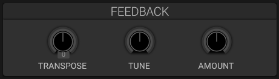

# Oscillator Feedback

## Overview

The feedback section routes the oscillator output back to modulate the oscillators, creating self-modulation effects.

## Parameters

### Feedback Amount

- **Range**: -100% to +100%
- **Effect**: Intensity of feedback modulation
- **Negative values**: Inverted feedback

### Transpose

- **Range**: -24 to +24 semitones
- **Purpose**: Pitch shift the feedback signal

### Tune

- **Range**: -100 to +100 cents
- **Purpose**: Fine-tune feedback pitch

## Sonic Characteristics

- **Low amounts**: Subtle harmonic enrichment
- **Medium amounts**: Resonant, formant-like tones
- **High amounts**: Aggressive, distorted timbres
- **Negative amounts**: Phase-inverted resonances

## See Also

- [Oscillators](oscillators.md)
