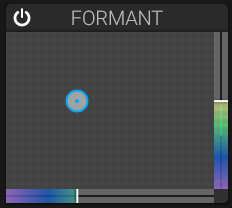

# Formant Filter

## Overview

The formant filter creates vowel-like sounds by emphasizing multiple frequency bands simultaneously.

## Parameters

### Formant X

Horizontal position in the formant space.

- Morphs between different vowel sounds

### Formant Y

Vertical position in the formant space.

- Adjusts formant character and brightness

### Resonance

Controls the sharpness of formant peaks.

### Blend

Mixes between the formant filter and the main filter.

- **0%**: Only main filter
- **100%**: Only formant filter

## Vowel Spaces

The formant filter can produce sounds reminiscent of:

- A (as in "father")
- E (as in "bed")
- I (as in "see")
- O (as in "home")
- U (as in "you")

## Applications

- Vocal-like synthesizer sounds
- Talking bass lines
- Expressive leads
- Sound effects

## See Also

- [Filter](filter.md)
- [Modulation](modulation.md)
