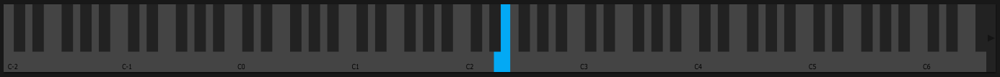

# Keyboard

## Overview

The on-screen keyboard provides visual feedback and manual note input when no MIDI controller is connected.

## Features

### Visual Feedback

- **Pressed Keys**: Highlighted when notes are active
- **Velocity**: Color intensity indicates velocity
- **Polyphony**: Shows all currently playing notes

### Mouse Input

- **Click**: Trigger note with fixed velocity
- **Drag Up/Down**: Adjust velocity before release
- **Multiple Notes**: Click multiple keys for chords

### Computer Keyboard

Use computer keyboard for note input:

- **White Keys**: QWERTY row (C, D, E, F, G, A, B)
- **Black Keys**: Number row (C#, D#, F#, G#, A#)
- **Octave Up/Down**: Z and X keys
- **Velocity**: Adjust with modifier keys

## Settings

### Octave Range

Displays current octave and allows shifting up/down.

### Velocity Curve

- **Linear**: Velocity proportional to press position
- **Fixed**: All notes at same velocity
- **Logarithmic**: Emphasis on higher velocities
- **Exponential**: Emphasis on lower velocities

### Computer Keyboard Layout

Configurable keyboard mapping for different keyboard layouts (QWERTY, AZERTY, etc.)

## Usage

### Manual Performance

- Play using mouse or computer keyboard

- Use for quick sound testing
- Useful for sound design without MIDI controller

### MIDI Input

When MIDI controller is connected:

- Keyboard shows incoming MIDI notes
- Still accepts mouse/keyboard input
- Useful for monitoring note activity

## See Also

- [Keyboard Mod](keyboard-mod.md)
- [Portamento](portamento.md)
- [Voices](voices.md)
