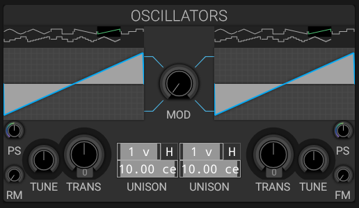

# Oscillators

## Overview

helmBoy features two primary oscillators that generate the fundamental sound.

For detailed technical documentation, see [helmBoy Oscillators Details](../OSCILLATORS.md).

## Quick Reference

### Oscillator 1 & 2

Each oscillator provides:

- **Waveform**: 11 different waveform types
- **Transpose**: -48 to +48 semitones
- **Tune**: Fine tuning in cents
- **Unison**: Up to 15 voices with detune
- **Phase Stretch**: Waveform shape modification
- **Volume**: Independent level control

### Modulation Options

- **Cross Modulation**: Mutual phase modulation between oscillators
- **FM Amount**: Frequency modulation (Osc 2 ? Osc 1)
- **Ring Modulation**: Amplitude modulation for metallic tones

## See Also

- [Feedback](feedback.md)
- [Sub Oscillator](sub.md)
- [Mixer](mixer.md)
