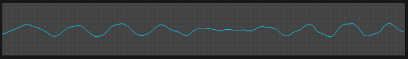

# Oscilloscope

## Overview

Real-time visual display of the output waveform.

## Features

- **Waveform Display**: Shows the actual synthesized waveform
- **Trigger Mode**: Stable waveform display synchronized to input
- **Zoom Controls**: Adjust time and amplitude scale
- **Freeze**: Capture and hold current waveform

## Usage

The oscilloscope helps visualize:

- Oscillator waveforms and their combinations
- Filter effects on the signal
- Modulation effects
- Overall output signal shape
