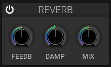

# Reverb

## Overview

The reverb effect simulates acoustic spaces, adding depth and ambience to sounds.

## Parameters

### Room Size

- **Range**: Small to Large
- **Effect**: Simulated space size
- **Small**: Tight, room-like reverb
- **Large**: Hall or cathedral-like reverb

### Decay Time

Time for the reverb to fade to silence.

### Damping

- **Low values**: Bright, reflective surfaces
- **High values**: Dark, absorptive surfaces

### Dry/Wet Mix

Balance between original signal and reverb.

### Pre-Delay

Time before reverb begins after the initial signal.

- Creates separation between direct sound and reverb
- Useful for maintaining clarity

### Feedback

Amount of reverb signal fed back into itself.

- Creates longer, more complex reverb tails

## Reverb Types

### Room

Small space simulation, early reflections dominant.

### Hall

Large space simulation, smooth reverb tail.

### Plate

Metallic plate reverb, bright character.

### Spring

Mechanical spring reverb, vintage character.

## Applications

- Adding space and depth
- Creating ambient soundscapes
- Smoothing harsh sounds
- Blending multiple sound sources

## See Also

- [Delay](delay.md)
- [Volume](volume.md)
