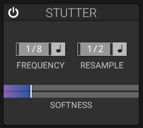

# Stutter Effect

## Overview

The stutter effect captures and repeats small segments of audio, creating glitch-like rhythmic effects.

## Parameters

### Frequency

- **Range**: 0.1 Hz to 100 Hz
- **Effect**: Rate of stuttering
- **Tempo Sync**: Can lock to musical divisions

### Gate

- **Range**: 0% to 100%
- **Effect**: Duration of each stutter repeat
- **Low values**: Short bursts
- **High values**: Longer repeats

### Window Size

Duration of the captured audio segment.

### Mix

Balance between clean signal and stuttered signal.

### Softness

Fades edges of stutter segments for smoother or harder cuts.

## Stutter Types

### Glitch

Fast, short stutters for glitch effects.

### Rhythmic

Tempo-synced for musical rhythms.

### Freeze

Very long window, captures and holds audio.

## Applications

- EDM risers and drops
- Glitch hop effects
- Rhythmic variations
- Sound design textures
- Live performance effects

## See Also

- [Step Sequencer](step-sequencer.md)
- [Delay](delay.md)
