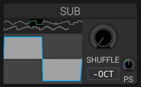

# Sub Oscillator

## Overview

The sub oscillator generates low-frequency content, typically one or two octaves below the main oscillators.

## Parameters

### Waveform

- **Sine**: Pure low-end
- **Square**: Adds harmonic content

### Octave

- **-1 Octave**: One octave below
- **-2 Octaves**: Two octaves below

### Volume

Controls the level of the sub oscillator in the mix.

## Usage Tips

- Add weight to bass sounds
- Enhance kick drum synthesis
- Create sub-bass layers
- Add foundation to leads and pads

## See Also

- [Oscillators](oscillators.md)
- [Mixer](mixer.md)
