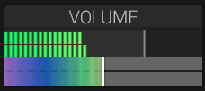

# Volume

## Overview

The master volume control sets the overall output level of helmBoy.

## Parameters

### Master Volume

- **Range**: -? dB to 0 dB
- **Default**: -6 dB (to prevent clipping)
- **Purpose**: Final output level control

### Volume Display

- Shows current level in dB
- Visual meter indicates output level
- Clip indicator warns of overload

## Usage

### Setting Output Level

1. Start with volume at -6 dB
2. Adjust based on mix requirements
3. Watch for clipping indicator
4. Leave headroom for mastering

### Gain Staging

- **Oscillators**: Individual levels set in mixer
- **Filter**: Can add or remove gain
- **Effects**: Can boost or attenuate signal
- **Master Volume**: Final output adjustment

## Level Management

### Avoiding Clipping

- Monitor output meter
- Reduce oscillator/mixer levels if clipping occurs
- Use master volume for final level adjustment
- Consider filter drive and effect levels

### Headroom

Leave 3-6 dB of headroom for:

- Dynamic range
- Mastering processing
- Preventing digital clipping

## See Also

- [Mixer](mixer.md)
- [Amplitude Envelope](amplitude-envelope.md)
