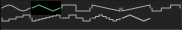

# Waveforms

## Overview

Waveform selection controls for oscillators and LFOs.

## Available Waveforms

### Oscillator Waveforms

- Sine
- Triangle
- Square
- Down Saw
- Up Saw
- Three Step
- Four Step
- Eight Step
- Three Pyramid
- Five Pyramid
- Nine Pyramid

### LFO Waveforms

- Sine
- Triangle
- Square
- Sawtooth
- Sample and Hold: holds one random value for most of the cycle, then eases to
  the next value at the cycle boundary
- Sample and Glide: smoothly interpolates between two random values over a cycle
- Smooth Random: continuously interpolates across several random points per cycle

## Waveform Display

The **PH** control offsets the waveform cycle from -180° to +180°; **PS**
changes its phase shape. The waveform display previews both controls. Random
previews show one representative cycle; their values are illustrative.
